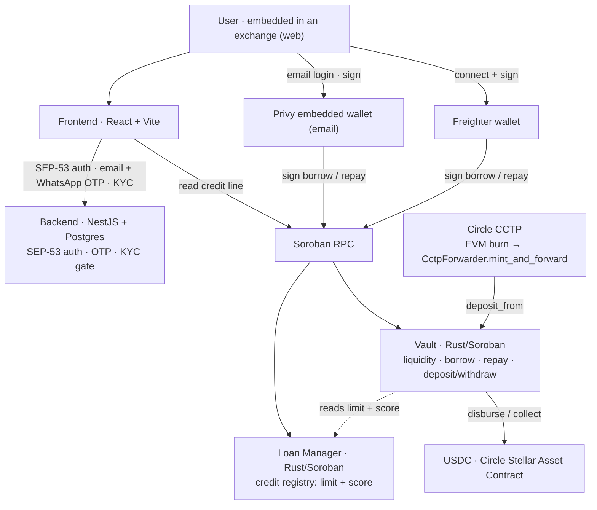
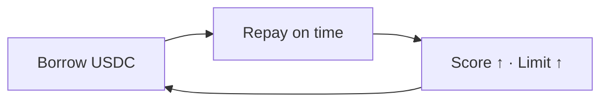

# Lendoor · Stellar

**Embedded, uncollateralized credit for Latin America's credit-invisible — built on Stellar.**

Built for the **PULSO Hackathon** (NearX × Stellar Development Foundation, Argentina track), now funded by the **Stellar Community Fund (SCF #45, Integration Track)**.

Lendoor is the credit layer a wallet plugs into to extend uncollateralized, on-chain credit to the **186M+ adults** in LatAm the formal system can't score. The full lifecycle — **borrow → repay → score** — runs on **Soroban** and is **live end-to-end on Stellar testnet**, settling in **Circle's USDC**.

### Links

- 🟢 **Live app:** https://stellar.lendoor.xyz/borrow
- 📦 **SCF #45 · Tranche 1 evidence (CCTP · Privy · KYC gate):** [`docs/deliverables/scf-tranche1/`](docs/deliverables/scf-tranche1/README.md) · video: https://youtu.be/GK3kB8p4P30
- 🎥 **PULSO demo video:** https://youtu.be/ga_5pt-i9Ns
- 🐦 **Project:** [@LendoorProtocol](https://x.com/LendoorProtocol) · **Founder:** [@lucho_leonel1](https://x.com/lucho_leonel1)

> To try it: **sign in with email** (Privy embedded wallet — no browser extension, no seed phrase) or connect **Freighter** on **Test Net**. On testnet a new email wallet is activated automatically (testnet XLM via friendbot + the USDC trustline). Borrowing is gated by an identity check — a sandbox KYC provider on testnet.

---

## The bet

There is a live version of Lendoor already running on Celo, distributed inside the **Lemon** wallet. This project makes the same move on a different stack:

> **Lemon on Celo → Bitso on Stellar.**

Same thesis (embedded credit for the credit-invisible), swapped to the rails where it can scale fastest in the region: an exchange like **Bitso** as the distribution surface, and **Stellar + USDC** as the money rail.

## Why now (and why Stellar)

- **186M+ credit-invisible adults** in LatAm — people the formal system can't underwrite, so they never get credit.
- The payment rails are getting solved (Argentina's **Transferencias 3.0**, the region's high demand for **digital dollars**). The missing layer is **credit on top of those rails**, for people no one can score without collateral.
- Stellar gives us cheap, ~5s USDC settlement and a real LatAm anchor/wallet ecosystem to reach those users.

## How it works

1. **Onboard once.** The user signs in with **email** (a self-custodial Privy embedded Stellar wallet) or connects **Freighter**, verifies email + WhatsApp OTP, and passes an **identity check (KYC gate)** before the first borrow. *In production the exchange's existing KYC plugs in behind the same port — the user is already identity-verified.*
2. The protocol issues a small **uncollateralized** loan on Stellar, sized by the user's on-chain credit limit, disbursed instantly.
3. Repaying on time **raises the limit** — a credit ladder that compounds trust.
4. The repayment history becomes a **portable on-chain credit score** that travels with the user across integrations.

Lending liquidity can arrive from other chains: **Circle CCTP** bridges USDC into the vault (burn on an EVM chain → Circle attestation → `mint_and_forward` on Stellar → `deposit_from` into the vault).

The hard, defensible part is not the lending pool. It is **underwriting the invisible without collateral**: limits start tiny and grow only with on-time repayment (exposure is always *earned* and capped), recovery rides identity + score consequences instead of seizing assets, and the repayment data is **portable and on-chain**.

## Architecture



The credit lifecycle, as a compounding loop:



## Stellar integration (load-bearing, not on a slide)

The entire credit protocol runs on Stellar — it is the integration, not a bolt-on:

- **Soroban smart contracts (Rust):** two composed contracts in `contratos/` — a **Vault** (liquidity + uncollateralized borrow/repay/deposit/withdraw, ERC-4626-style, plus `deposit_from` for bridged deposits) and a **Loan Manager** (per-wallet credit limit + score). The full borrow → repay → score lifecycle runs on-chain.
- **Circle CCTP:** an executor in `backend/src/cctp/` takes a Circle attestation, calls `mint_and_forward` on Circle's Stellar `CctpForwarder` and deposits into the vault with `deposit_from`.
- **Privy embedded wallets** (email login, self-custodial, key export) and **Freighter**; Privy signs Soroban transactions and **SEP-53 messages** for backend auth.
- **KYC gate:** `POST /loan/borrow` is blocked until identity is verified; the provider sits behind a single port (sandbox on testnet).
- **`@stellar/stellar-sdk` + Soroban RPC** for contract invocation and reads; contracts deployed and seeded with the **Stellar CLI**.
- **Settlement in USDC** (Circle's Stellar Asset Contract) for disbursement and repayment.

### Live on testnet

| Contract | Address |
|---|---|
| Vault | [`CCXUEBC3VOOB57NVDFMQVAJRN52FUQN37EAPLVMAU7MLSPUBMZNBVT2Q`](https://stellar.expert/explorer/testnet/contract/CCXUEBC3VOOB57NVDFMQVAJRN52FUQN37EAPLVMAU7MLSPUBMZNBVT2Q) |
| Loan Manager | [`CB4QQU2JWC6264NQCUPE6WSVYQHJTJNJ5ZBVU7ZAOE7TYNJPYE26YVTD`](https://stellar.expert/explorer/testnet/contract/CB4QQU2JWC6264NQCUPE6WSVYQHJTJNJ5ZBVU7ZAOE7TYNJPYE26YVTD) |
| USDC (Circle SAC) | [`CBIELTK6YBZJU5UP2WWQEUCYKLPU6AUNZ2BQ4WWFEIE3USCIHMXQDAMA`](https://stellar.expert/explorer/testnet/contract/CBIELTK6YBZJU5UP2WWQEUCYKLPU6AUNZ2BQ4WWFEIE3USCIHMXQDAMA) |

> Settlement is **Circle's testnet USDC** with **7-decimal accounting** (classic Stellar assets, mainnet USDC included, use 7 decimals, unlike EVM USDC's 6). The original PULSO build ran on an earlier pair that used the native XLM asset contract as a USDC stand-in; the SCF #45 deliverables run on the pair above.

## SCF #45 · Tranche 1 (testnet)

| Deliverable | Evidence | Code |
|---|---|---|
| **D1.1 — Circle CCTP into the vault** | [`d1.1-cctp-evidencia.md`](docs/deliverables/scf-tranche1/d1.1-cctp-evidencia.md) | [PR #5](https://github.com/LuchoLeonel/lendoor-stellar/pull/5) |
| **D1.2 — Privy embedded-wallet onboarding** | [`d1.2-privy-evidencia.md`](docs/deliverables/scf-tranche1/d1.2-privy-evidencia.md) · [video](https://youtu.be/GK3kB8p4P30) | [PR #7](https://github.com/LuchoLeonel/lendoor-stellar/pull/7) · [PR #8](https://github.com/LuchoLeonel/lendoor-stellar/pull/8) |
| **D1.3 — KYC gate before borrow** | [`d1.3-kyc-evidencia.md`](docs/deliverables/scf-tranche1/d1.3-kyc-evidencia.md) · [`d1.3-kyc-app-evidencia.md`](docs/deliverables/scf-tranche1/d1.3-kyc-app-evidencia.md) | [PR #6](https://github.com/LuchoLeonel/lendoor-stellar/pull/6) · [PR #12](https://github.com/LuchoLeonel/lendoor-stellar/pull/12) |

Index with every transaction: [`docs/deliverables/scf-tranche1/README.md`](docs/deliverables/scf-tranche1/README.md).

## Repo structure

```
lendoor-stellar/
├── frontend/    # Lendoor web app — Privy + Freighter, Soroban wired (borrow, repay, lend, account)
├── backend/     # NestJS — SEP-53 auth, email + WhatsApp OTP, KYC gate, CCTP executor, chain sync, Postgres
├── contratos/   # Soroban smart contracts (Rust): vault + loan-manager (+ tests, parity & migration docs)
├── packages/    # generated Soroban TypeScript bindings (vault-client, loan-manager-client)
├── shared/      # types shared across frontend/backend
├── docs/        # deliverable evidence (SCF #45, Instaward) and code reviews
└── specs/       # thesis, Stellar integration, customer discovery, submission checklist
```

- **frontend/** — React + Vite. Wallets: `src/providers/PrivyStellarProvider.tsx` (Privy email wallet) and `src/lib/stellar-wallet.ts` (Freighter), behind one signer registry; Soroban calls in `src/lib/stellar-contracts.ts`. Borrow, repay, the account funds block (deposit/withdraw to the vault) and the lend market all run against Soroban.
- **backend/** — NestJS: SEP-53 wallet login, real email (ZeptoMail) + WhatsApp (Kapso) OTP, the KYC gate (`src/kyc/`), the CCTP executor (`src/cctp/`), chain sync, DB persistence (TypeORM + Postgres).
- **contratos/** — the Rust contracts, with a test suite, `PARITY.md` (EVM↔Soroban equivalence) and `MIGRATION_EVM_TO_SOROBAN.md`.

## Tech stack

Rust / Soroban · `@stellar/stellar-sdk` · Privy · Freighter · Circle CCTP · React + Vite + TypeScript · NestJS + TypeORM + Postgres · Docker.

## Status

- ✅ **Live on testnet:** Soroban contracts settling in Circle USDC; full borrow → repay → score lifecycle (incl. partial and late repayment); CCTP bridge into the vault; Privy email onboarding with key export; KYC gate before borrow (sandbox provider); Freighter auth; email + WhatsApp OTP; vault deposit/withdraw; web app at `stellar.lendoor.xyz`.
- 🛣️ **Roadmap:** mainnet USDC, real KYC vendor behind the same port, DeFindex idle-buffer yield, anchor on/off-ramp (SEP-24/31), external LPs, and the identity-based recovery layer (reminders / AI voice).

## Team & origin

Built by Argentine builders shipping on Stellar. Derived from the live Lendoor codebase (Celo/EVM, real loans on mainnet) — this is the Stellar-native build for PULSO, continued under SCF #45.
